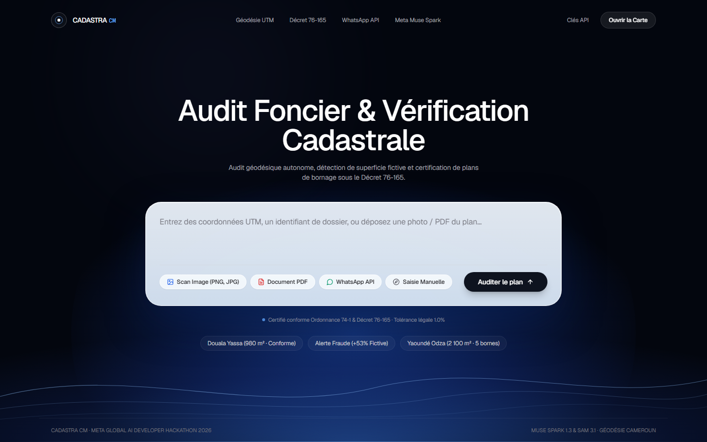
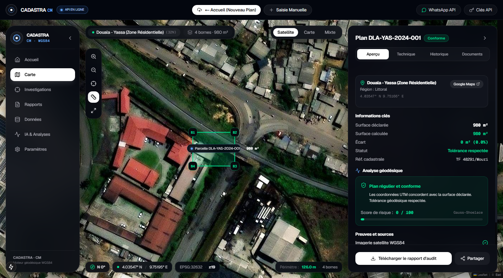
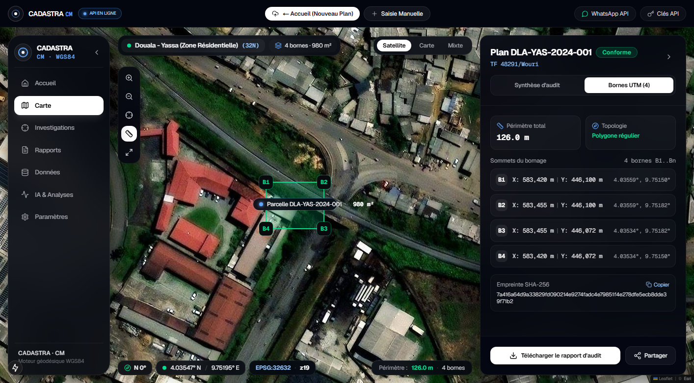
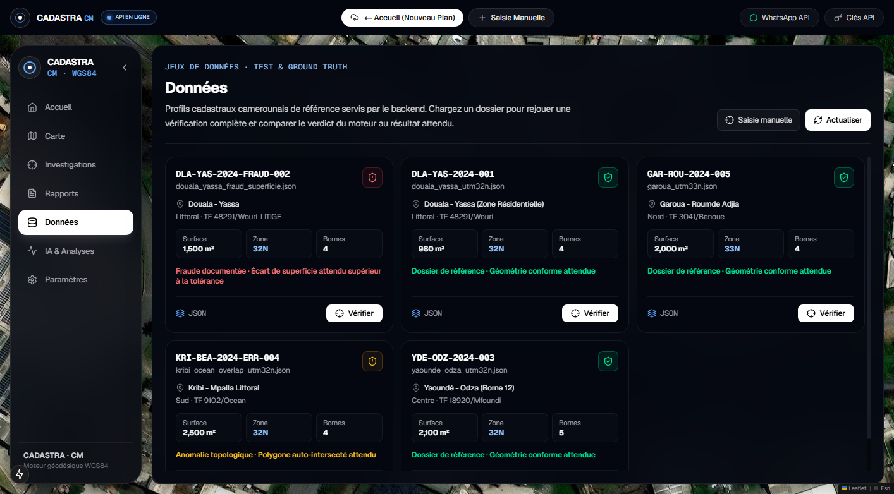

# Cadastra-Cameroon

### Autonomous Cadastral Audit & Geodetic Land Fraud Detection Platform
**Meta Global AI Developer Hackathon 2026**

---

## 1. Project Identity

- **Project Name:** Cadastra-Cameroon (CADASTRA CM)
- **Tagline:** Autonomous Geodetic Audit & Cadastral Risk Analysis Powered by Meta AI
- **Track / Event:** Meta Global AI Developer Hackathon 2026
- **Target Jurisdiction:** Republic of Cameroon (MINDCAF Cadastral Framework, UTM Zones 32N & 33N)
- **Languages:** Native Bilingual Support (English and French)

---

## 2. The Problem: Land Insecurity & Cadastral Risk in Cameroon

Property acquisition across Cameroon and the Central African sub-region faces deep structural challenges rooted in paper-based archives, fragmented records, and manual survey workflows. Land buyers, banks, diaspora investors, and conveyancing notaries frequently confront three critical failure modes:

1. **"Superficie Fictive" (Fraudulent Surface Inflation):** Paper boundary plans (*Plans de Bornage*) frequently state an inflated parcel area (for example, declaring 1,500 m² for a plot whose physical boundary beacons enclose only 980 m²). This gap is exploited to overvalue collateral, inflate compensation during expropriation, or defraud buyers who cannot independently calculate coordinates.
2. **Topological Defects & Coordinate Inconsistencies:** Boundary polygons with unclosed perimeters (where beacon $B_n$ does not return to $B_1$), self-intersecting boundary lines (figure-eight or bow-tie anomalies), or inverted Easting/Northing coordinates that place the parcel in an entirely different administrative zone.
3. **UTM Projection & Ellipsoid Confusion:** Cameroon spans two Universal Transverse Mercator (UTM) zones: **Zone 32N** (`EPSG:32632`, Western, Littoral, and Central regions) and **Zone 33N** (`EPSG:32633`, Northern and Eastern regions). Coordinates computed in one zone but plotted in another produce massive positional shifts and distorted area figures.

Without specialized surveying software or access to a licensed surveyor before placing a purchase deposit, buyers face substantial financial loss and years of litigation.

---

## 3. The Solution: Independent Mathematical & AI-Assisted Audit

**Cadastra-Cameroon** is an independent, automated cadastral screening instrument. It bridges the gap between raw surveying data and everyday legal due diligence:

- **Instant Plan Ingestion:** Ingests boundary survey plans via document drop (PDF / JPG), manual coordinate entry, or mobile submission.
- **Deterministic Mathematical Verification:** Reconstructs the true boundary polygon in projected metric space (UTM 32N / 33N), evaluates perimeter closure, and compares declared vs. computed surface area.
- **AI Forensic Analyst:** Translates complex geodetic discrepancies into plain-language legal assessments in English and French, identifying specific statutory risks before funds are transferred.
- **Bilingual Cadastral Audit Reports:** Generates standardized, tamper-evident audit summaries complete with SHA-256 cryptographic fingerprints.
- **Civic Inclusion via WhatsApp:** Extends verification capabilities to mobile users through automated WhatsApp interaction, ensuring access for citizens without high-speed internet or desktop computers.

### Primary Beneficiaries
- **Property Buyers & Diaspora Investors:** Independent pre-acquisition due diligence to verify that physical boundaries match claimed dimensions.
- **Notaries & Legal Practitioners:** Fast, verifiable technical checks to include in conveyance dossiers prior to authentic act execution.
- **Credit Institutions & Microfinance:** Collateral validation before approving real estate and agricultural loans.
- **Surveying Professionals:** Rapid quality assurance of boundary closure and coordinate integrity before formal submission.

---

## 4. Visual Demonstration & Interface

The application interface follows a dark geodetic instrument design language built for technical clarity, high contrast, and zero visual clutter.

### A. Landing Page & Plan Ingestion Hub
Drop any survey plan image or PDF, select a benchmark parcel, or input raw UTM coordinates directly.



### B. Inspection Dashboard & Fraud Detection
Reconstructs parcel geometry on high-resolution satellite imagery, displaying real-time risk scores and discrepancy badges.



### C. Cadastral Forensic Dossier & Boundary Beacons Table
Detailed coordinate schedules displaying Easting, Northing, converted WGS84 Lat/Long, and boundary segment lengths.



### D. AI Analyst & Ground-Truth Benchmark Profiles
Interactive reasoning tab with statutory recommendations alongside pre-configured ground-truth verification profiles.



---

## 5. How Meta AI is Used

Cadastra employs Meta technologies across three complementary layers of the verification workflow. We maintain complete transparency regarding actual API integrations, architectural roles, and offline fallbacks:

```
┌─────────────────────────────────────────────────────────────────────────────┐
│                            Meta AI Ingestion Layer                          │
│                                                                             │
│   Meta SAM 3.1 (Segment Anything)          Meta Muse Spark / LLaMA          │
│   [Document ROI Segmentation]              [Structured Table Extraction]    │
│   • Isolates beacon coordinate tables      • Parses B1..Bn labels & meters  │
│   • Masks noisy background stamps          • Extracts stated area & title   │
└──────────────────────────────────────┬──────────────────────────────────────┘
                                       │
                                       ▼
┌─────────────────────────────────────────────────────────────────────────────┐
│                 Deterministic Geodetic Math & Validation Core               │
│                                                                             │
│   FastAPI + PyProj + Shapely                                                │
│   • Planar Gauss-Shoelace area integration in projected UTM metric space    │
│   • WGS84 ellipsoidal transformation (EPSG:4326)                            │
│   • Boundary closure & topological self-intersection audit                  │
│   • SHA-256 digital fingerprint generation                                  │
└──────────────────────────────────────┬──────────────────────────────────────┘
                                       │
                                       ▼
┌─────────────────────────────────────────────────────────────────────────────┐
│                         Meta AI Reasoning & Civic Layer                     │
│                                                                             │
│   Meta Muse Spark / LLaMA 3.3              Meta WhatsApp Cloud API          │
│   [Interactive Forensic Analyst]           [Field Citizen Verification]     │
│   • Free-form legal Q&A (EN / FR)          • Mobile coordinate submission   │
│   • Statutory buyer recommendations        • Automated audit text summaries │
│   • Contextual risk explanations           • PDF report delivery via link   │
└─────────────────────────────────────────────────────────────────────────────┘
```

### Detailed Meta AI Component Matrix

| Meta Component | Integration Method | Primary Role | Fallback / Test Architecture |
|---|---|---|---|
| **Meta Muse Spark / LLaMA** | Live Cloud API / REST Endpoint | **1. Structured Parsing:** Converts raw cadastral text and OCR streams into typed beacon coordinates ($X, Y$).<br>**2. Forensic Analyst:** Conducts free-form contextual Q&A in English and French, explaining geometric discrepancies in terms of buyer risks, negotiation leverage, and legal remedies. | **Deterministic Cadastral Rule Engine:** If the remote API key is unconfigured or request times out (>18s), the engine falls back to a deterministic 10-category legal assessment model grounded in Cameroonian property law. |
| **Meta Segment Anything (SAM 3.1)** | Computer Vision Pipeline | **Region-of-Interest (ROI) Extraction:** Designed to segment and crop coordinate tables (*cartouches de bornage*), surveyor stamps, and boundary sketches from physical, wrinkled, or low-contrast paper documents. | **Heuristic Crop & Unit Mocks:** In the hackathon prototype, image extraction utilizes bounding-box contour detection; offline test suites (`test_sam.py`) utilize mock bounding boxes to validate downstream geometry parsing without requiring heavy local GPU hardware. |
| **Meta WhatsApp Cloud API** | Webhook Server (`/api/webhook/whatsapp`) | **Mobile Accessibility:** Receives inbound boundary coordinates or plan images via WhatsApp, runs the verification engine, and sends back an instant summary with a secure link to the PDF report. | **Interactive In-Browser Simulator:** Includes a built-in WhatsApp Web simulation modal so evaluators can test the full mobile conversational flow without needing an active WhatsApp Business number. |

---

## 6. How It Works: Verification Pipeline

```
[Survey Plan Document: PDF / Image / Coordinates]
                       │
                       ▼
       ┌───────────────────────────────┐
       │     Document Ingestion        │
       │  • SAM 3.1 ROI Segmentation   │
       │  • LLaMA Structured Extraction│
       └───────────────┬───────────────┘
                       │ Validated Beacon Coordinates (X, Y)
                       ▼
       ┌───────────────────────────────┐
       │   Deterministic Geodetic Core │
       │  • UTM Zone 32N / 33N Ingest  │
       │  • Gauss-Green Shoelace Math  │
       │  • Perimeter Loop Closure     │
       │  • Shapely Topology Analysis  │
       │  • SHA-256 Hash Computation   │
       └───────────────┬───────────────┘
                       │ Comprehensive Verification Object
                       ▼
       ┌───────────────────────────────┐
       │  Meta AI Reasoning & Delivery │
       │  • Muse Spark Cadastral Q&A   │
       │  • Bilingual Report Engine    │
       │  • WhatsApp Webhook Dispatch  │
       └───────────────────────────────┘
```

1. **Ingestion & Extraction:** The user provides a survey plan. The system extracts the metadata (title number, stated area, owner, locality, surveyor name) and boundary beacon table ($B_1 \dots B_n$ with UTM Easting $X$ and Northing $Y$).
2. **Topological Validation:** The engine verifies that at least three non-collinear beacons are provided. It checks boundary closure by measuring the distance between the final beacon and the origin beacon.
3. **Planar Surface Calculation:** The engine computes the enclosed area on the projected 2D Cartesian plane using the Gauss-Green (Shoelace) formula in square meters ($m^2$).
4. **Discrepancy Evaluation:** The computed area is compared against the stated area on the plan. If the discrepancy exceeds the configured tolerance threshold (default: 1.0%), a risk flag is raised. If the declared area exceeds the true area by a significant margin, it is flagged as *Superficie Fictive*.
5. **Ellipsoidal Mapping:** Coordinates are converted to WGS84 geographic coordinates (`EPSG:4326`) for satellite visualization.
6. **AI Explanation & Reporting:** The verification summary is passed to the AI analyst for contextual explanation and compiled into a downloadable audit report with an SHA-256 fingerprint.

---

## 7. Core Capabilities

### A. Geodetic & Mathematical Precision
- **Planar Area via Gauss-Green (Shoelace Theorem):** Area computation is performed strictly in projected metric space (UTM Easting and Northing in meters).
- **WGS84 Ellipsoidal Transformation:** PyProj converts projected coordinates to geodetic latitude and longitude on the WGS84 ellipsoid, ensuring precise geographic pin placement and satellite overlay.
- **Perimeter Closure Audit:** Detects unclosed perimeters where the surveyor's loop does not close within standard field tolerance.
- **Topological Integrity (Shapely):** Identifies self-intersecting polygons (figure-eight or bow-tie errors) caused by misordered beacon entries or boundary line crossovers.
- **SHA-256 Tamper-Evidence:** Generates an immutable digital hash of the input coordinate sequence, audit metrics, and timestamp to provide verifiable provenance.

### B. Interactive AI Forensic Analyst
- Interactive conversational interface supporting plain-language inquiries in English and French.
- Answers buyer and notary questions, including:
  - Explanation of area deficits and legal remedies.
  - Identification of surveying anomalies that require a licensed surveyor's rectification.
  - Price negotiation guidance based on calculated acreage deficits.
  - Boundary dispute risks under Cameroonian statutory procedures.

### C. Bilingual Cadastral Audit Reports
- Compiles a complete audit dossier into a downloadable PDF report formatted in accordance with standard administrative conventions.
- Features dual-language headers (*République du Cameroun / Republic of Cameroon*), complete beacon coordinates schedules, variance tables, and cryptographic verification seals.
- Supports English, French, and comprehensive bilingual output modes.

### D. WhatsApp Cloud API Citizen Channel
- Enables citizens and diaspora buyers to audit coordinates directly from their phones.
- Handles automated inbound text parsing, formats structured responses, and provides verified download links.

---

## 8. Technical Architecture & Stack

### Backend
- **Framework:** FastAPI (Python 3.12)
- **Geodetic & Geometric Libraries:**
  - `pyproj` (PROJ geodetic transformation engine)
  - `shapely` (GEOS geometric and topological analysis library)
- **Document Generation:** `reportlab` (dynamic vector PDF generation with dual-pass page numbering)
- **Validation:** Pydantic v2 schemas with strict typing
- **Testing:** `pytest` (42 comprehensive automated unit and integration tests)

### Frontend
- **Framework:** Next.js 15 (App Router, React 19)
- **Styling:** Tailwind CSS (Geodetic Instrument Dark Palette: `#060709`, `#0B0E14`, `#10141D`, `#00DF8F`)
- **Mapping:** Leaflet & React-Leaflet with ESRI World Imagery satellite base tiles
- **Animation & UI:** Framer Motion, Lucide React (strictly zero generic sparkle icons)
- **Internationalization:** Complete client-side English/French dictionary with real-time toggle

---

## 9. Judge's Evaluation Walkthrough

Follow these instructions to run the project locally and evaluate all capabilities:

### Prerequisites
- Python 3.12+ installed
- Node.js 18+ and npm installed
- Git

### Step 1: Clone the Repository

```bash
git clone https://github.com/EonEmmanuel/Cadastra-Cameroon.git
cd Cadastra-Cameroon
```

### Step 2: Run the Automated Test Suite (Backend)

The test suite contains 42 tests covering geodetic math, UTM zone projections, boundary closure, self-intersections, and API routes:

```powershell
# Set Python path and run pytest
$env:PYTHONPATH="backend"
backend\.venv\Scripts\pytest -v
```
*Expected result: **42 passed, 0 failed**.*

### Step 3: Start the Backend Service (Port 8000)

```powershell
backend\.venv\Scripts\uvicorn backend.main:app --host 127.0.0.1 --port 8000 --reload
```
- Swagger API Docs: [http://127.0.0.1:8000/docs](http://127.0.0.1:8000/docs)
- Health Telemetry: [http://127.0.0.1:8000/health](http://127.0.0.1:8000/health)

### Step 4: Start the Frontend Application (Port 3000)

In a separate terminal window:
```bash
cd frontend
npm install
npm run dev
```
Open **[http://localhost:3000](http://localhost:3000)** in your browser.

### Step 5: Test Key Scenarios in the Application

1. **Evaluate a Fraudulent Survey Plan (+53% Fictitious Area):**
   - On the homepage, click **"Explore Ground-Truth Profiles"** (or use the navigation bar to go to **Datasets**).
   - Select the profile: **"Fraud Alert (+53% Fictitious)"** (`douala_yassa_fraud_superficie.json`).
   - Observe the satellite map render the true polygon boundary in red.
   - Review the **Cadastral Forensic Dossier**: stated area is `1,500.00 m²`, calculated area is `980.00 m²`, flagging an immediate critical discrepancy of `+53.06%`.
2. **Download the Bilingual Cadastral Audit Report:**
   - In the right-hand panel, click the primary action button: **"Download"** (or **"Téléchargement"** in French).
   - The verified PDF audit report will download immediately, featuring the dual state header, beacon schedule, discrepancy analysis, and SHA-256 seal.
3. **Query the AI Forensic Analyst:**
   - In the dossier panel, select the **"AI Analyst"** tab.
   - Click the suggested prompt: *"Is this parcel safe to purchase?"* or ask a custom question (e.g., *"What are my legal remedies for this area deficit?"*).
   - Observe the immediate, tailored legal assessment referencing applicable Cameroonian legal protections.
4. **Test Bilingual Language Parity:**
   - Toggle the **EN / FR** switcher in the top navigation header. The entire interface, metric labels, AI prompts, and generated reports seamlessly switch language.
5. **Test the WhatsApp Channel Simulator:**
   - Click the **WhatsApp** icon in the toolbar or header to open the interactive mobile audit simulator.

---

## 10. Benchmark Cadastral Datasets

The repository includes five verified ground-truth test profiles representative of Cameroonian land scenarios:

| Dataset | Locality & Region | UTM Zone | Stated Area | Computed Area | Verification Verdict |
|---|---|---|---|---|---|
| `douala_yassa_utm32n.json` | Douala Yassa, Littoral | UTM 32N | 980.0 m² | 980.0 m² | **COMPLIANT** (0.0% variance, low risk) |
| `douala_yassa_fraud_superficie.json` | Douala Yassa, Littoral | UTM 32N | 1,500.0 m² | 980.0 m² | **CRITICAL FRAUD** (+53.06% fictitious area) |
| `yaounde_odza_utm32n.json` | Yaoundé Odza, Centre | UTM 32N | 2,100.0 m² | 2,100.0 m² | **COMPLIANT** (5-beacon closed boundary) |
| `kribi_ocean_overlap_utm32n.json` | Kribi Mpalla, Sud | UTM 32N | 2,500.0 m² | Invalid | **TOPOLOGICAL ANOMALY** (Self-intersecting figure-8) |
| `garoua_utm33n.json` | Garoua Roumde, Nord | UTM 33N | 2,000.0 m² | 2,000.0 m² | **COMPLIANT** (UTM Zone 33N legal projection) |

---

## 11. REST API Endpoints

| Method | Endpoint | Description |
|---|---|---|
| `POST` | `/api/verify` | Core geodetic calculation: planar area, closure verification, WGS84 mapping, and fraud scoring. |
| `POST` | `/api/ai/qa` | Interactive cadastral forensic AI Q&A powered by Meta AI with deterministic fallback. |
| `GET` / `POST` | `/api/report/pdf` | Generates and streams bilingual PDF cadastral audit reports (`bilingual`, `en`, or `fr`). |
| `POST` | `/api/extract` | Document segmentation and coordinate extraction from survey plan images and PDFs. |
| `POST` | `/api/webhook/whatsapp` | Webhook endpoint handling Meta WhatsApp Cloud API mobile interactions. |
| `GET` | `/api/profiles` | Returns available benchmark cadastral parcel profiles. |
| `GET` | `/health` | Service health status, geodetic runtime telemetry, and configuration state. |

---

## 12. Limitations & Disclaimers

To maintain technical integrity and legal accuracy, the scope and limitations of Cadastra-Cameroon are explicitly defined:

1. **Not a Government Determination:** Cadastra-Cameroon is an **independent mathematical audit and screening platform**. It is not an agency of the Government of Cameroon and its generated reports do not constitute official administrative acts, land certificates (*Certificats d'Urbanisme*), or Land Titles (*Titres Fonciers*).
2. **Licensed Surveyor Requirement:** Under Cameroonian Law No. 80-21 of 14 July 1980, physical boundary demarcation and official cadastral plan drafting are reserved exclusively for licensed cadastral surveyors (*Géomètres-Experts agréés*) enrolled in the *Ordre des Géomètres du Cameroun (OGEC)*. Cadastra assists users in verifying and understanding survey data; it does not replace a licensed surveyor.
3. **Physical Monumentation:** The platform mathematically verifies the coordinates provided on paper documents and digital entries. It cannot independently verify whether physical concrete monuments (*bornes*) on the ground have been physically displaced, buried, or removed without an on-site field inspection.
4. **Tolerance Application:** The 1.0% tolerance threshold is an engineering benchmark commonly applied in urban surveying practice under Decree 76-165 guidelines; specific administrative tolerances may vary depending on terrain classification (urban vs. rural) and local cadastral directives.

---

## 13. Statutory Framework & Acknowledgements

### Cameroonian Statutory References
The rule engine and AI analyst reference the following core legal instruments:
- **Ordonnance n° 74-1 du 6 juillet 1974:** Fixant le régime foncier et domanial au Cameroun.
- **Décret n° 76-165 du 27 avril 1976:** Fixant les conditions d'obtention du titre foncier, modifié et complété par le Décret n° 2005/481 du 16 décembre 2005.
- **Loi n° 80-21 du 14 juillet 1980:** Portant organisation de la profession de géomètre et création de l'Ordre des Géomètres du Cameroun (OGEC).
- **Code Civil Camerounais (Articles 1616 à 1622):** Dispositions relatives à la délivrance et à la garantie de contenance dans la vente immobilière.
- **Code Pénal Camerounais (Articles 316 et 318):** Sanctionnant le déplacement de bornes et les manœuvres frauduleuses sur la propriété foncière.

### Open-Source Technologies
- **Meta AI:** Segment Anything Model (SAM), Muse Spark / LLaMA, WhatsApp Cloud API.
- **Geospatial Foundations:** OSGeo PROJ (`pyproj`), GEOS (`shapely`), OpenStreetMap & ESRI World Imagery contributors.
- **Web & Typography:** Next.js by Vercel, Tailwind CSS, ReportLab, Inter typeface.

---
*Built with precision for the Meta Global AI Developer Hackathon 2026.*
